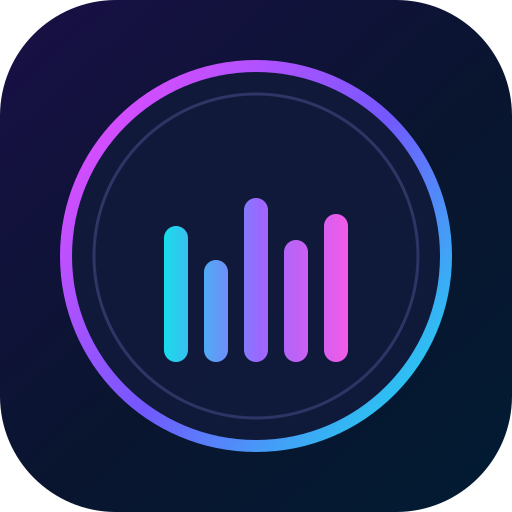

<!--
  MusikKu project README
  Keep release links and project details in sync with the latest tagged release.
-->

<div align="center">

  

  <h1>MusikKu</h1>
  <p><strong>Your music library. Your listening style.</strong></p>
  <p>An independent Android music player for online discovery, local playback, and a more personal music library.</p>

  <p>
    <a href="https://github.com/Rulzz77/Musikku/releases/latest">
      
    </a>
    <a href="https://github.com/Rulzz77/Musikku/releases">
      
    </a>
    <a href="https://github.com/Rulzz77/Musikku/blob/main/LICENSE">
      
    </a>
  </p>
  <p>
    <a href="https://github.com/Rulzz77/Musikku/actions/workflows/check.yml">
      
    </a>
    <a href="https://github.com/Rulzz77/Musikku/actions/workflows/release-android.yml">
      
    </a>
  </p>

  <p>
    <a href="#download">Download</a> ·
    <a href="#features">Features</a> ·
    <a href="#build-from-source">Build from source</a> ·
    <a href="#project-structure">Project structure</a> ·
    <a href="#privacy-and-limitations">Privacy & limitations</a>
  </p>

</div>

---

## About

**MusikKu** is an independent Android music player that brings online music discovery and local audio playback together with tools for organising playlists, understanding listening habits, and managing an offline library.

> **Current source version:** `0.1.72` (`versionCode 73`). The Download section always links to the latest release that has actually been published.

The Android application is built with **Kotlin and Jetpack Compose**. The repository also contains shared Kotlin modules, Android TV and Wear OS targets, a Go service for Listen Together, and a web player with a companion browser extension.

> MusikKu is an independent project. It is not an official YouTube Music, YouTube, Google, or Spotify application, and it is not affiliated with or endorsed by those services.

## Download

The latest stable build is available from GitHub Releases. APK links below always point to the **latest published release**.

<div align="center">

  <a href="https://github.com/Rulzz77/Musikku/releases/latest">
    
  </a>

</div>

| APK | Recommended for |
|---|---|
| [**ARM64**](https://github.com/Rulzz77/Musikku/releases/latest/download/MusikKu-arm64-v8a.apk) | Most modern Android phones and tablets |
| [**ARMv7**](https://github.com/Rulzz77/Musikku/releases/latest/download/MusikKu-armeabi-v7a.apk) | Older 32-bit ARM Android devices |
| [**Universal**](https://github.com/Rulzz77/Musikku/releases/latest/download/MusikKu-universal.apk) | Devices where the correct CPU architecture is unknown; larger download |
| [**x86_64**](https://github.com/Rulzz77/Musikku/releases/latest/download/MusikKu-x86_64.apk) | x86_64 Android devices and emulators |
| [**Wear OS**](https://github.com/Rulzz77/Musikku/releases/latest/download/MusikKu-WearOS.apk) | Compatible Wear OS watches |

**Installation:** download the APK for your device, allow your browser or file manager to install unknown apps when Android asks, then install the package. For the full changelog and all release assets, visit [Releases](https://github.com/Rulzz77/Musikku/releases).

## Features

### Discover and play music

- Browse and search music available through the integrated YouTube Music catalogue.
- Play audio files from your device's local music library.
- Keep listening in the background with Android media-session, notification, and lock-screen controls.
- Manage the playback queue, playback history, shuffle, repeat, and track navigation.
- Use supported lyrics providers, adjust lyric synchronisation, and customise lyric text size.
- Fine-tune playback with speed controls, silence skipping, a sleep timer, equalizer integration, and network-aware quality settings.
- Use the optional USB audio path with compatible devices and supported source formats.

Availability and playback behaviour depend on the selected source, account state, region, device, and third-party service.

### Organise your library

- Create and manage device playlists.
- Import Spotify playlists into MusikKu and keep imported collections available locally.
- Group YouTube Music, Spotify-imported, and device playlists with **Playlist Folders**.
- Sort and organise playlists, manage tracks individually or in batches, and customise playlist artwork.
- Like or unlike tracks by double-tapping their artwork in Library track lists, playlist and album track lists, and search results.
- On the expanded Player Page, double-tap anywhere in the large artwork area — including the surrounding space around the cover — to Like or unlike the currently playing track. Like plays an animated heart burst; Unlike flashes a centre crack and splits the heart into two halves that move apart and fade. The existing Like control beside the track details remains available.
- Show a persistent pink heart with a green check in the top-right corner of the expanded Player Page artwork while the current track is liked. The marker fades out when the track is unliked and works for locally saved guest Likes as well as signed-in YouTube Music Likes.
- Guest users can Like and unlike streamed tracks without signing in. Double-tapping the expanded Player Page artwork gives the same Like burst or split-heart Unlike animation and haptic feedback. These Likes are saved locally in **Local Music → Playlists → Liked** by track video ID and stay on that device; they do not change the user's YouTube Music account. Signed-in Likes continue to sync through YouTube Music.
- Keep local listening statistics and revisit recently played or favourite music.

### Smart Playlists

Smart Playlists turn listening statistics into dynamic collections. Built-in lists include:

- **Most played**
- **Recently played**
- **Most listened**
- **Forgotten tracks**

Create up to 20 custom Smart Playlists with optional artist, cached genre, release-year, duration, and last-played filters. Combine optional criteria with **ALL (AND)** or **ANY (OR)**, then sort by play count, recent playback, or listening time.

Genre, release-year, and duration filters depend on metadata being available. Missing metadata is not guessed; a track without the required value will not match that active filter.

Read the [Smart Playlists guide](docs/SMART_PLAYLISTS.md).

### Downloads, storage, and data safety

- Manage downloaded music and inspect app-managed storage usage.
- Recover queued and interrupted download tasks after the app is opened again.
- Review downloaded files, audio cache, artwork cache, and Canvas cache separately.
- Export and restore supported app data, including playlists, playlist folders, Spotify-imported collections, listening statistics, and Smart Playlist rules.
- Choose playlist merge or replacement behaviour during restore.

See the guides for [Backup & Restore](docs/BACKUP_RESTORE_2026-11-16.md), [Download Recovery](docs/DOWNLOAD_RECOVERY_2026-11-16.md), and [Storage Manager](docs/STORAGE_MANAGER_2026-11-16.md).

### Personalisation and listening tools

- **Music DNA** and **Memories** provide summaries based on local listening history.
- **MusikKu Flow** creates mood-oriented mixes from available track metadata and listening history.
- Save favourite artists, customise themes, and manage tracks hidden from Flow.
- Keep a manual **Radio Diary**, use the **Focus Timer**, or switch to the in-app **Car Mode** layout.
- Use **Listen Together** to synchronise playback and queues with other participants on a configured server.

Flow recommendations depend on the metadata and history available on the device. Listen Together requires a reachable party server.

### Companion projects

The repository contains more than the Android phone app:

| Module | Purpose |
|---|---|
| `tv/` | Android TV application |
| `wearos/` | Wear OS companion application |
| `backend/` | Go backend for Listen Together |
| `web/` | Web player and companion browser extension |

The companion projects have their own setup and build steps; see the documentation inside each module before using or deploying them.

## Build from source

### Requirements

| Tool | Version / setting |
|---|---|
| JDK | 17 |
| Android SDK | Platform 37 (compile SDK) |
| Android NDK | Required for native audio components |
| CMake | 3.22.1 |
| Android minimum SDK | API 26 |
| Android target SDK | API 36 |

Android Studio is recommended for installing the Android SDK, NDK, and CMake components. The repository's Gradle wrapper selects the Gradle version used by the project.

### Clone the repository

```bash
git clone https://github.com/Rulzz77/Musikku.git
cd Musikku
```

On Linux or macOS, make the wrapper executable if necessary:

```bash
chmod +x gradlew
```

### Build the production-flavour debug APK

**Windows PowerShell**

```powershell
.\gradlew.bat :app:assembleProdDebug -Pmusikku.bundleWear=false
```

**Linux / macOS**

```bash
./gradlew :app:assembleProdDebug -Pmusikku.bundleWear=false
```

To build the separate development application instead:

```bash
./gradlew :app:assembleDevDebug -Pmusikku.bundleWear=false
```

The APK is normally written to:

```text
app/build/outputs/apk/prod/debug/
```

The production application ID is `id.musikku.player`; the development application ID is `id.musikku.dev`.

### Run tests

```bash
./gradlew :shared:jvmTest testDevDebugUnitTest
```

Run Gradle commands from the repository root. Android builds and tests are also checked by the repository's GitHub Actions workflows.

### Optional local configuration

Some integrations use local credentials or service URLs. Put optional development values in the root `local.properties` file; do not commit real keys or secrets.

```properties
LASTFM_API_KEY=your_lastfm_api_key
LASTFM_SECRET=your_lastfm_secret
LISTEN_TOGETHER_SERVER=https://your-listen-together-server.example
```

Release signing is handled separately from ordinary debug builds. Never commit a keystore, signing password, API secret, or populated local configuration file.

## Project structure

```text
Musikku/
├── app/          # Native Android application (Kotlin + Jetpack Compose)
├── shared/       # Shared Kotlin business logic and data models
├── sharedUi/     # Shared UI components
├── tv/           # Android TV target
├── wearos/       # Wear OS companion
├── backend/      # Listen Together Go service
├── web/          # Web player and browser extension
├── docs/         # Feature, design, and implementation notes
├── LICENSE       # GPL-3.0 license
└── README.md
```

## Privacy and limitations

A few important boundaries are intentional:

- **No music hosting:** MusikKu is a player and client. It does not operate a catalogue or host the music that users play.
- **Third-party dependencies:** online catalogues, lyrics, scrobbling, and other integrations may depend on external services, their availability, account access, and their terms.
- **Listen Together:** when you create or join a party, the configured party server receives a random per-installation device ID, a participant ID derived with SHA-256, your party display name, the host’s autoplay preference when creating the party, and shared playback/queue metadata such as video ID, title, artist, thumbnail URL, duration, and playback controls. On Android, the participant ID is derived from the installation ID; the app sends the locally chosen nickname and does not send a Google/YouTube account ID or profile avatar. In the web player, the participant ID is derived from the signed-in YouTube Music login/channel identifiers; the raw identifiers and browser cookies/tokens are not sent to the party server. The web player sends the selected channel’s display name (unless you set a party nickname) and may send its public avatar URL. Unless you configure another server, the Android app’s built-in party-server address is `https://bitchord-listen-together.onrender.com`; the web deployment uses its configured `VITE_PARTY_SERVER_URL`. Choose a server you trust before sharing party activity. The server operator and hosting provider can observe requests and associated network metadata.
- **No permanent ad-free or service-availability promise:** MusikKu does not guarantee that a third-party service will remain available, change its policies, or provide a particular playback experience.
- **Smart Playlist metadata:** genre tags and release-year/runtime metadata may be missing for some tracks. Filters only use values actually supplied or cached.
- **Backup scope:** backups do not bundle downloaded audio bytes, app caches, account credentials, or API secrets. Local-file references may need to be relinked when moving a backup to another device.
- **Download recovery:** an interrupted item can be queued again when the app is reopened, but the current downloader does not promise byte-for-byte partial download resumption.

Use music sources and content only where you have the necessary rights and permissions, and follow the applicable third-party service terms and local laws.

## Documentation

- [Smart Playlists](docs/SMART_PLAYLISTS.md)
- [Playlist Folders](docs/PLAYLIST_FOLDERS.md)
- [Backup & Restore](docs/BACKUP_RESTORE_2026-11-16.md)
- [Download Recovery](docs/DOWNLOAD_RECOVERY_2026-11-16.md)
- [Storage Manager](docs/STORAGE_MANAGER_2026-11-16.md)
- [Lyrics Translation](docs/LYRICS_TRANSLATION.md)
- [Remote Configuration](docs/REMOTE_CONFIG.md)
- [Web player and extension](web/README.md)
- [Listen Together backend](backend/README.md)
- [Fork information](MUSIKKU_FORK_INFO.md)

## License and third-party notices

MusikKu is distributed under the **GNU General Public License v3.0 (GPL-3.0)**. See [LICENSE](LICENSE) and [third-party notices](THIRD_PARTY_NOTICES.md) for license terms, upstream attribution, and required notices. If you redistribute a modified build, comply with the GPL, preserve required notices, and provide the corresponding source code.

<div align="center">
  <sub>Made for listeners who want more control over their music library.</sub>
</div>
